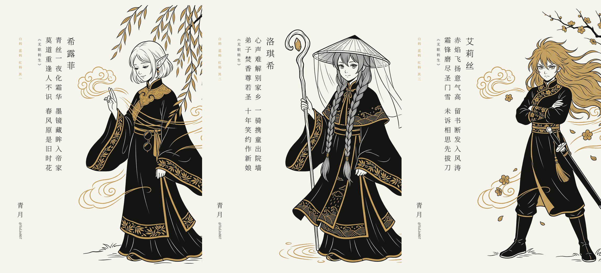

# poem-plate

**AI 画人物，代码排诗：把古诗和古典人物做成一张留白讲究、可以直接发的诗意插画。**

poem-plate 是一个给 Claude Code 等 AI agent 用的诗画合成技能：生图模型画人物，Python 代码负责留白、配色和竖排中文诗句，帮写古诗/判词配图的创作者做出文字零错字、系列风格统一的 3:4 古典诗意插画（小红书 / X 可直接用）。

An agent skill + Python compositor for AI-illustrated classical Chinese poem plates with accurate vertical CJK typesetting.

一个给 Claude Code 等 AI agent 用的技能（skill）。生图模型负责人物的画功；代码负责把画缩到一侧、压成统一的纸色 / 墨色 / 单一金色、边缘羽化，再在大片留白里竖排原文、出处和落款。


<sub>温庭筠《菩萨蛮》+ 朱庆馀《近试上张籍水部》。上图为最终成品，生图原图满版见 [examples/xinfu-raw.jpg](examples/xinfu-raw.jpg)。</sub>

## 为什么要合成

- 生图模型原图是满版的，人物太满，没有地方放诗，中文字也会写成乱码。
- 纯代码画线稿，人体和手很难画对。
- 合成版两头取长：画交给模型，留白、配色、文字交给代码，文字永远准确，系列风格永远统一。

## 适用场景 / 和其他做法比

| 做法 | 问题 / 特点 |
|---|---|
| 生图模型直接出图 | 人物太满，没有地方放诗，中文字常写成乱码 |
| 纯代码画线稿 | 人体和手很难画对 |
| **poem-plate 合成** | 画交给模型，留白、配色、文字和版式交给代码 |

适合：古诗配图、红楼梦人物插画、动漫角色古风同人、成系列的社交媒体诗画。

## 它做什么

- **文字先核实**：诗句、出处逐字对照可靠全文，画里不放任何字。
- **出图提示词骨架**：1920s Art Deco 墨线插画、单一金色、留出左侧空白；按人物性格写神态；写明朝代服饰。
- **代码合成**（`compose_lib.py`）：去边框、纸色压平、边缘羽化与提亮、缩放推到右侧、纸墨金色映射、竖排中文（《》自动旋转），文字压到画上会直接报错。
- **严格评审**：六项打分，手畸形、错字、服饰朝代错、性感化都算 P0，不清零不交付。


## v2：动漫角色 × 古典画法



现在可以把动漫角色画成古典诗画，由三个旋钮自由组合：

| 旋钮 | 选项 |
|---|---|
| **字** | 红楼式判词：工整、押韵、对仗的七言绝句，按平水韵校平仄和粘对，每句藏一个剧情典故 |
| **色** | 克制色板：一种纸色、一种墨色，加一种强调色 |
| **笔** | Art Deco 墨线，或 11 种中国古典人物画法：洛神赋、吴带当风、唐仕女、敦煌飞天、李公麟白描、陈洪绶、十二金钗……每种都附提示词骨架和高清图链接，见 [styles/classical-styles.md](styles/classical-styles.md) |

| 角色 | 判词 |
|---|---|
| 希露菲 | 青丝一夜化霜华，墨镜藏眸入帝家。莫道重逢人不识，春风原是旧时花。 |
| 洛琪希 | 心声难解别家乡，一骑携童出院墙。弟子焚香尊若圣，十年笑约作新娘。 |
| 艾莉丝 | 赤焰飞扬意气高，留书断发入风涛。霜锋磨尽圣门雪，未诉相思先拔刀。 |

系列合成脚本在 `compose/`：`compose_lib.py` 是系列版（固定版式骨架，指定哪几条边出血、不羽化，其余边提亮），`compose_bw.py` 让半句之间只空半格，`example_mushoku.py` 是上面这三张的参数。

这些脚本里的 `cl_*.png` 等原图不随仓库提供，请换成你自己的生图原图路径；`compose_bw.py` 需要 scipy；系列版同样要用 `POEM_FONT` 指定中文字体（它默认找仓库根目录下的 `fonts/NotoSerifSC-Light.otf`，仓库里不带这个文件）。

## English

**poem-plate** is an agent skill that turns classical Chinese poems and characters into minimal, print-like illustrated plates. An image model draws the figure; `compose_lib.py` scales it to one side, maps everything to a strict cream / near-black / single-gold palette, feathers the edges, and typesets the poem, its source, and a signature vertically in the empty space. A strong reviewer model scores each plate and blocks delivery on P0 issues (malformed hands, wrong characters, wrong-era costume). The skill itself is written in Chinese.

**v2** adds anime characters × 11 classical Chinese figure-painting styles, with Dream-of-the-Red-Chamber-style verse (判词). Keywords: AI illustration, vertical Chinese text, poem image generator, agent skill.

## 安装

方式一（推荐）：

```bash
git clone https://github.com/ythx-101/poem-plate ~/.claude/skills/poem-plate
cd ~/.claude/skills/poem-plate
pip install -r requirements.txt
```

方式二：只下载需要的文件：

```bash
mkdir -p ~/.claude/skills/poem-plate
cd ~/.claude/skills/poem-plate
for f in SKILL.md compose_lib.py example_compose.py requirements.txt styles/classical-styles.md; do
  curl -L --create-dirs -o "$f" https://raw.githubusercontent.com/ythx-101/poem-plate/main/$f
done
pip install -r requirements.txt
```

如需系列版，再把 `compose/compose_lib.py compose/compose_bw.py compose/example_mushoku.py` 加进上面的文件列表。只用单张合成可以只装 `numpy pillow`；`scipy` 仅 `compose/compose_bw.py` 需要。

需要一个中文衬线字体（推荐 [Noto Serif SC](https://fonts.google.com/noto/specimen/Noto+Serif+SC) Light），用 `POEM_FONT` 指定路径；`POEM_SIGNATURE`、`POEM_HANDLE` 改成你自己的署名。

## 快速开始

1. 装依赖：`pip install -r requirements.txt`
2. 设环境变量（字体必设，署名按需）：
   ```bash
   export POEM_FONT=/path/to/NotoSerifSC-Light.otf
   export POEM_SIGNATURE=你的署名
   export POEM_HANDLE=@your_handle
   ```
3. 用仓库自带的原图跑一遍：
   ```bash
   python example_compose.py examples/xinfu-raw.jpg out.png
   ```

`example_compose.py` 里的 `COLUMNS` 从右往左排，每项是 `(文字, big|mid|small, 列后间距)`。如果报告画面压到文字留白区，调低 `scale_cap`（或直接传 `scale=...`）。

最小冒烟测试：`POEM_FONT=/path/to/字体文件 python tests/smoke_test.py`（没设字体会打印 skip）。

## FAQ

**为什么不让 AI 直接把诗写进画里？** 生图模型写中文常常乱码，所以画里不放任何字，文字全部由代码排。

**用什么生图模型？** 任何能出 3:4 插画的都行。

**需要什么字体？** 任意中文衬线体，推荐 Noto Serif SC Light，用 `POEM_FONT` 指定。

**文字压到画上怎么办？** 脚本会直接报错；调低 `scale_cap` 或传 `scale`。

**怎么改落款？** 设 `POEM_SIGNATURE` 和 `POEM_HANDLE`。

**能做动漫角色吗？** 能，见上面的 v2：判词 + 11 种古典画法，详见 [styles/classical-styles.md](styles/classical-styles.md)。

**不用 Claude Code 能用吗？** 能。合成脚本是独立的 Python，可以单独跑；`SKILL.md` 是给 agent 读的流程说明。

## License

MIT
